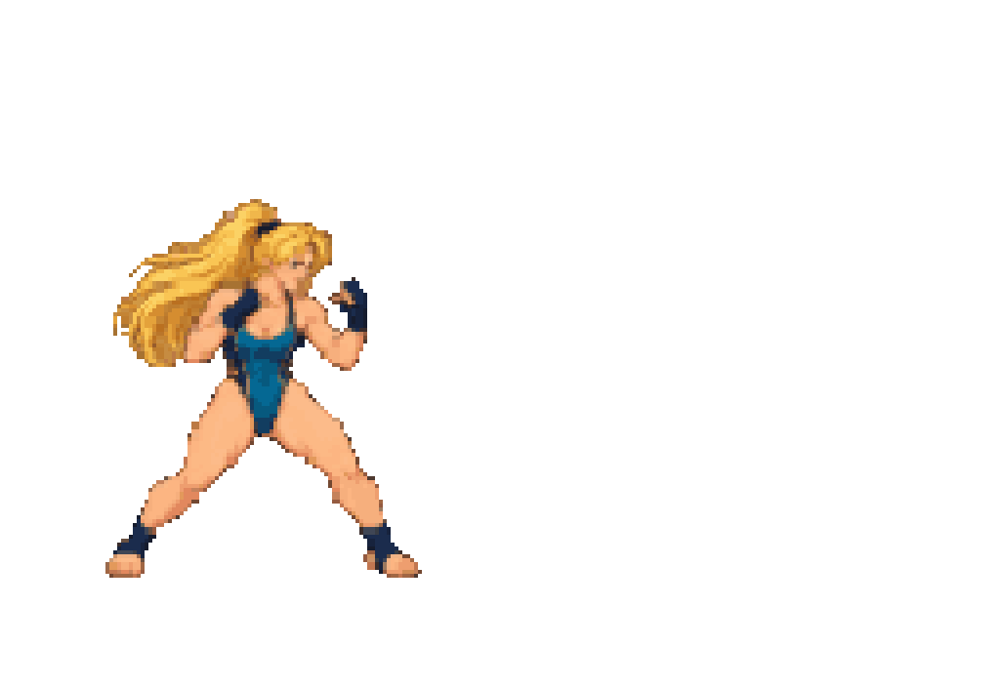

# DOTFLIP Studio

画像をドット絵に変換し、ピクセルを編集し、コマを重ねてアニメーションを作るブラウザアプリです。日本語UI。Codexなどのコンピュータユーズからも操作できます。

Pixel art and frame animation editor that runs in your browser. Import images or sprite sheets, edit pixels, and export looping GIFs. All image processing runs locally in the browser; no API key is required.

**[Web版を開く — DOTFLIP Studio](https://get2437.github.io/dotflip-studio/)** · [ダウンロード版](https://github.com/get2437/dotflip-studio/releases/latest)



サンプルのキャラクター画像はAI生成です。開発にもAIを使用しています。画像の出自と利用条件は [ASSETS.md](ASSETS.md)、コードと同梱素材のライセンスは [LICENSE](LICENSE)、外部ライブラリの表示は [THIRD_PARTY_NOTICES.md](THIRD_PARTY_NOTICES.md) を参照してください。

## ブラウザですぐ使う

[GitHub PagesのWeb版](https://get2437.github.io/dotflip-studio/)をChrome / Edgeなどの新しいブラウザで開くだけで使えます。Node.jsのインストール、GitHubへのログイン、APIキーは不要です。

「完成サンプル『SURF STRIKE』を開く」で再生・編集を試すか、自分の画像を読み込んでドット絵とアニメーションを作成してください。GIFやPNG、プロジェクトJSONは手元の端末にダウンロードできます。

読み込んだ画像の処理と自動保存はブラウザ内で行います。自動保存は開いたURLとブラウザにひもづくため、別の端末へ移す場合やバックアップには「保存」でプロジェクトJSONを持ち出してください。

## ダウンロードしてローカルで使う

1. [Releases](https://github.com/get2437/dotflip-studio/releases/latest) から `dotflip-studio-v1.0.0.zip` をダウンロードして展開します。
2. [Node.js](https://nodejs.org/) 22以降を用意します。
3. Windowsでは展開したフォルダの `start-studio.cmd` を実行します。macOS / Linuxでは、そのフォルダで `npm start` を実行します。
4. 表示された `http://127.0.0.1:4173` をブラウザで開きます。終了するにはターミナルで `Ctrl+C` を押します。

リリースZIPにはビルド済みの `dist/` が含まれます。ZIPからの起動では `npm ci` や外部通信は不要です。Chrome / Edgeなどの新しいブラウザを使用してください。

## ソースからローカルで起動

ローカル起動と開発にはNode.js 22以降を使用します。Web版の利用には不要です。

```sh
git clone https://github.com/get2437/dotflip-studio.git
cd dotflip-studio
npm ci
npm run build
npm start
```

表示された `http://127.0.0.1:4173` を開きます。Windowsでは `start-studio.cmd` も使えます。`dist/` を静的HTTPサーバーで配信するだけで動き、画像処理用のバックエンド、APIキー、CDNは不要です。`file://` で直接開く方法はES modules / Workerの制約があるため使用しません。

## 主な操作

1. PNG / JPG / WebP / BMPを読み込みます。複数ファイルは自然順（01, 02, 10）で読み込まれます。1枚のスプライトシートは「スプライトシートを分割する」で等分グリッドに分割できます。
2. サイズ（1〜256px）、色数、パレット、ディザ、縮小方式を決め、「ドット絵に変換」。縦横の比率は「全体を収める」「中央で切り抜く」「サイズに合わせる」から選べます。
3. 鉛筆、消しゴム、塗りつぶし、スポイト、直線、四角形で手直しします。目のアイコン（T）で元画像を下絵として透かせます。範囲選択後は1px移動、左右反転、Deleteで範囲消去できます。
4. コマを複製・追加・並べ替え、オニオンスキンで前コマと比較します。各コマの表示時間は20〜5000ms。最大64コマ。
5. 「動きの下地」で上下移動、弾み、選択部分の左右移動、まばたきのコマを追加できます。まばたきは目を囲み、周囲の肌や毛と同じまぶたの色を指定します。
6. GIF、スプライトシートPNG＋座標・時間のJSONをまとめたZIP、単一コマPNGに書き出します。倍率は1/2/4/8倍、ニアレストで輪郭を維持。GIFはループ再生し、時間は10ms単位に丸めます。
7. 「保存」で `.dotflip.json` を持ち出し、「開く」で復元します。

## AIと協働する

### 連続ポーズから戦闘シーンを作る

透過背景のポーズを2〜16コマ用意し、「アクション演出」→「戦闘シーンを組み立てる」を開きます。16コマなら、構え・予備動作・ストレート・クロス・アッパー・踏み込み・ジャンプ・空中蹴り・回転蹴り・急降下・着地・回避・溜め・放出・反動・構えの順に並べると演出に合います。

「完成サンプル『SURF STRIKE』を開く」から、金髪の成人女性の戦闘ループを再生・編集できます。画像生成で作ったポーズを実際のUIから切り出し、変換・演出・書き出しした作品です。全コマのPNGシートと時間情報を軽量なサンプルとして同梱しています。

強さ、海辺／夜のステージ、残像、衝撃波、画面揺れを選べます。残像は標準でオフにし、明示的に選んだ場合だけ前のポーズを薄く重ねます。256×176px・64コマ・3.12秒のシーンを作り、各コマは通常の鉛筆や選択ツールで編集できます。元のコマはUndoで復元でき、先にJSONで保存すれば後から再利用できます。入力が16コマ未満ならポーズを割り当てて同じ長さに展開します。背景や訓練ドローンも編集用のピクセルに焼き込みます。

AI製のスプライトシートで手足が等分線を越えるときは、シート分割の「透過のまとまりを自動抽出」を選びます。アルファ128以上でつながる主要な塊を検出し、孤立した小さなごみを除いて、同じ縮尺・中央・足元基準にそろえます。背景が透明で、各キャラクターが離れている画像が必要です。接触したキャラクターを分離する機能はありません。等分グリッドでは画像サイズが割り切れなくても、全画素を隙間なく分割します。

このアプリはモデルを呼び出しません。GPT-6.1 Sol等のコンピュータユーズが外側から画面を操作するための作業環境です。画像の意味を解釈する作画はコンピュータユーズ側で行い、アプリは正確なグリッド、減色、編集、コマ管理、出力を担当します。詳しい操作方針は `COMPUTER_USE_GUIDE.md` にあります。

自動変換は縮小・減色による下地作りです。意味を理解して新しいポーズを描き起こす生成AI、人物・髪・服の自動セグメント分割、完全な背景切り抜きは内蔵していません。選択部分の移動では元の位置が透明になるため、必要に応じて下地を描き足してください。ソースは透過か単色背景、キャラクターの周囲に余白があると扱いやすくなります。

## 保存とプライバシー

- 読み込んだ画像と作業データはブラウザで処理します。アプリのコードにアップロード処理・外部モデル呼び出し・解析トラッカーはありません。
- 作業は同じブラウザ・同じオリジンのIndexedDBに自動保存します。別のURL・ブラウザ・端末とは同期しません。
- 複数画像を読み込んだとき、自動復元用の元画像は最初の1枚のみ保管します。変換後の全コマは復元されます。元の連番を再変換する場合は再度読み込んでください。
- プロジェクトJSONにはコマ、サイズ、色、時間を保存します。変換前の元画像は含まれません。
- ブラウザのデータ消去や容量不足に備え、保存ボタンでファイルを持ち出してください。
- Undoは最大30履歴、約48MBを目安に制限。大きい作品では履歴件数が減ります。

## 開発・検証

```powershell
npm run build
npm test
npm run release:package
```

`release:package` はビルド済みの `dist/` を含む配布ZIPとSHA-256チェックサムを `release/` に作成します。リポジトリには個人のサイトID・認証情報・作業画像・自動保存データを含めません。ビルドした `dist/` は任意の静的HTTPサーバーで配信できます。

`main`への更新はGitHub ActionsでWindows / Linuxのテストを通過した後、ビルド済みの`dist/`をGitHub Pagesに自動公開します。プルリクエストではテストのみ実行します。

`app/core.js` がDOMから独立した画像処理・コマ操作・JSON検証、`app/action.js` が透過スプライト抽出・戦闘シーン合成、`app/app.js` がUI、`app/export.js` がGIFとシート定義、`app/gif-worker.js` がGIFのバックグラウンド生成を担当します。色は全コマ共通のパレットで量子化し、アニメーション中の色のちらつきを抑えます。透明色と不透明の黒は別のGIFインデックスです。

GIF回帰試験は `artifacts/demo.gif` と元プロジェクトを出力します。検証方法は [QA.md](QA.md)、変更への参加方法は [CONTRIBUTING.md](CONTRIBUTING.md) を参照してください。

## OSS

GIFエンコーダーは [mattdesl/gifenc](https://github.com/mattdesl/gifenc) 1.0.3（MIT）を利用しています。ビルドでライブラリとライセンスを `dist/vendor/` に同梱します。[Piskel](https://github.com/piskelapp/piskel) と [Pixel It](https://github.com/giventofly/pixelit) は機能調査で参考にしましたが、コードは取り込んでいません。詳細は `THIRD_PARTY_NOTICES.md`。
